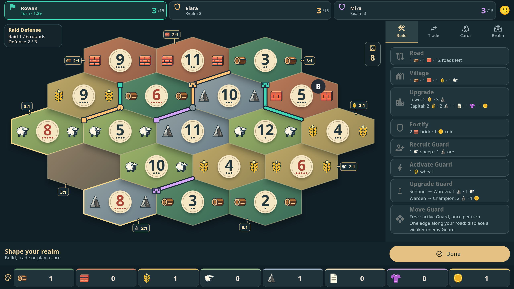
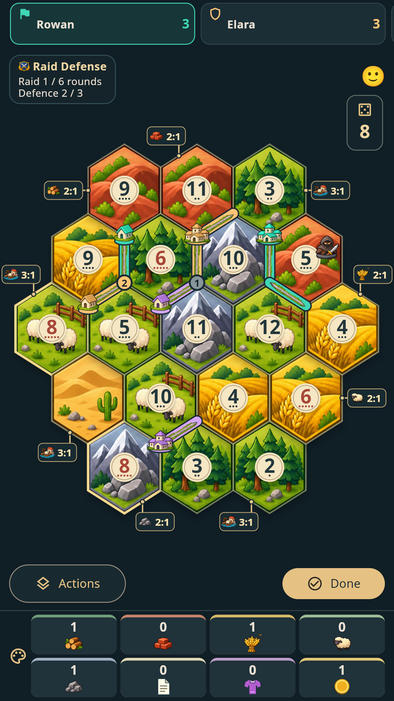
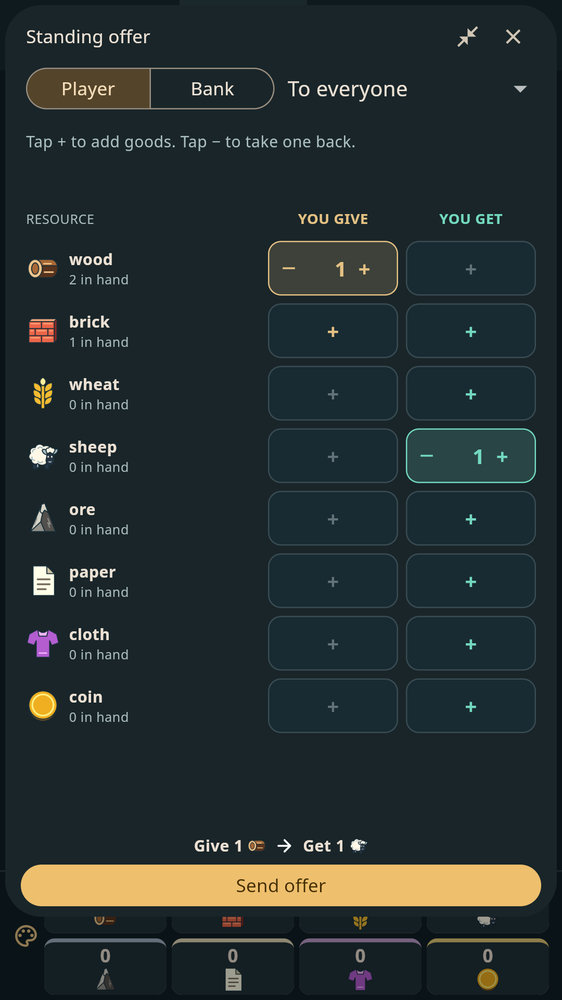
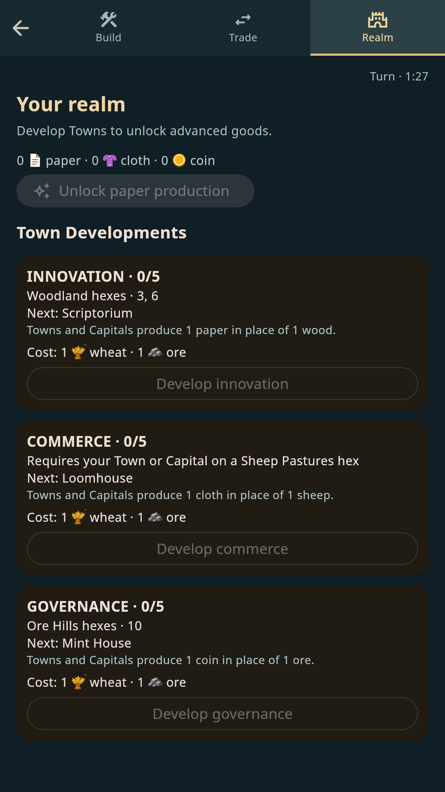

# Stone & Banner

A turn-based strategy board game. Build, trade and defend your realm. First to 15 Renown wins.

[Play online](https://brandonp2412.github.io/stone-and-banner/) | [Download for Android, Linux and Windows](https://github.com/brandonp2412/stone-and-banner/releases)

Play offline against bots, pass and play, or play with friends over LAN or P2P. Matches are saved automatically.



  

## Development

```sh
flutter pub get
flutter run -d chrome
flutter test
```

[Screenshots](fastlane/metadata/android/en-US/images) are generated on every push to main. [Release builds](https://github.com/brandonp2412/stone-and-banner/actions/workflows/release.yml) are generated on version tags or manually.
