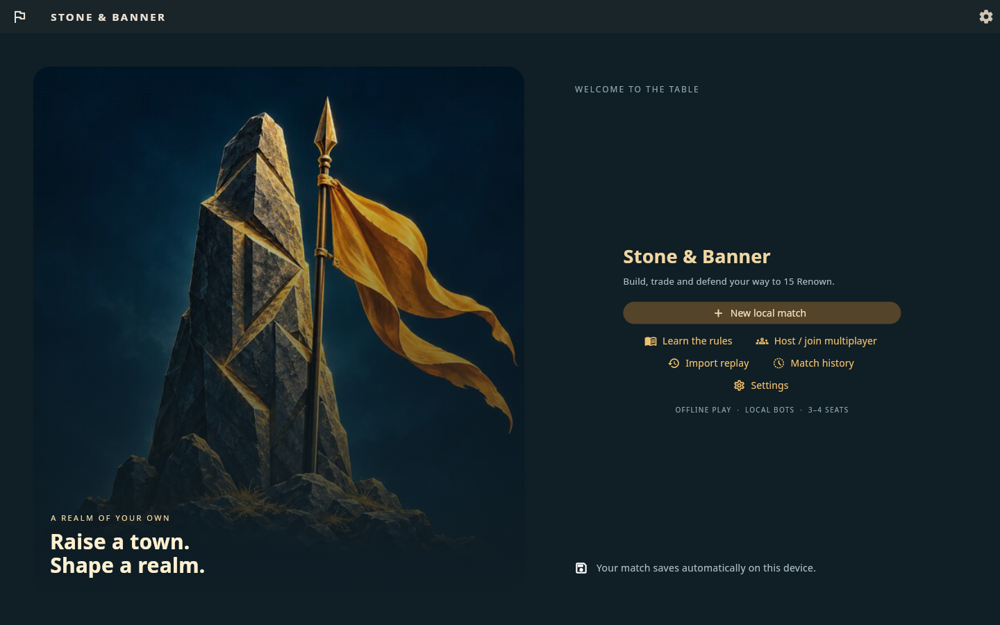
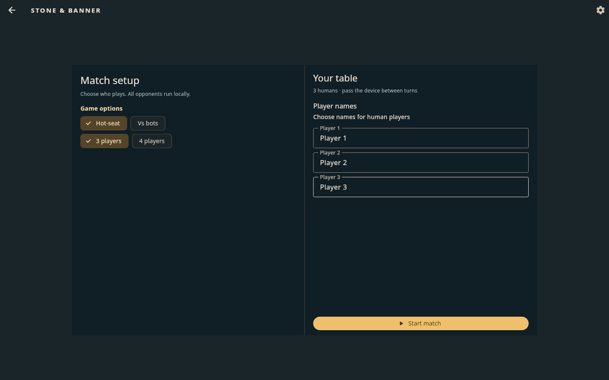
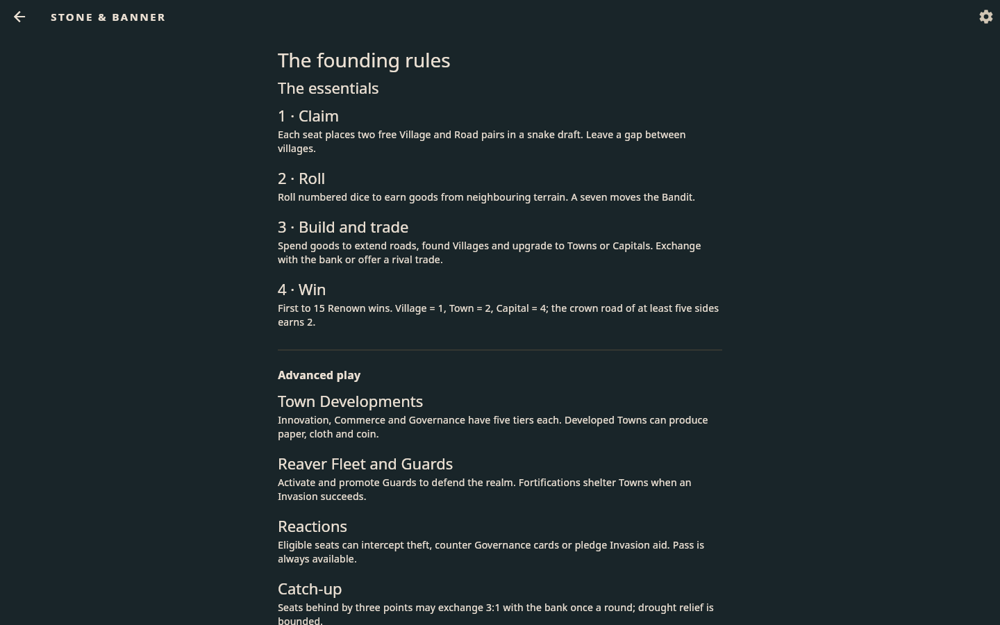
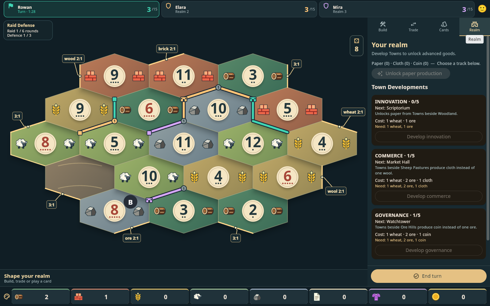
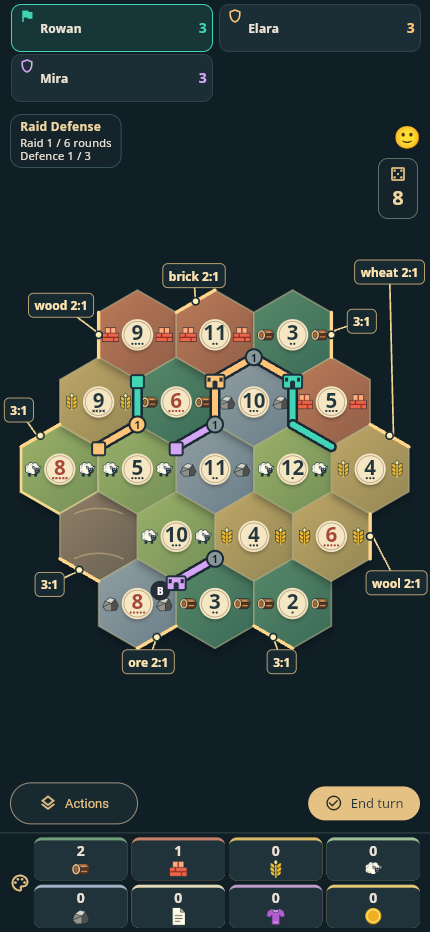

# Stone & Banner

Build villages, trade goods and defend your realm from raids. Grow your villages into towns and capitals, command guards, and compete with friends or bots to reach 15 Renown.

**[Play in your browser](https://brandonp2412.github.io/stone-and-banner/)** · **[Download for Android, Windows or Linux](https://github.com/brandonp2412/stone-and-banner/releases)**


## How to play

Each player begins by placing two free village-and-road pairs. The second village becomes a town. Choose sites beside useful terrain, leave space between villages, and connect roads to reach new sites.

On your turn, roll the dice to produce goods from neighbouring terrain. Spend goods to build, exchange them with the bank, or offer a trade to another player. Wood, brick, wheat, sheep and ore fund construction and guards. Developed towns can also produce paper, cloth and coins.

Use the game’s four panels to plan your turn:

- **Build:** Extend roads, found villages, upgrade towns and capitals, fortify your towns, and recruit or activate guards. Choose highlighted targets directly on the board.
- **Trade:** Offer bundles of goods to other players or exchange goods with the bank.
- **Cards:** Play strategy cards from Innovation, Commerce and Governance. Cards can provide goods, help construction, or disrupt rival plans.
- **Realm:** Review your holdings and develop your towns through five tiers in each of the three development tracks.

Raids threaten the whole table. Active guards contribute to shared defence; stronger ranks contribute more. Fortifications protect towns, and eligible players can pledge emergency aid when an invasion arrives. After the first raid, attackers gain one additional strength. Defending can award Guardian’s Honour, up to two Renown per player. A seven moves the Bandit and can trigger discards or theft.

The first player to reach 15 Renown wins. Villages contribute 1, towns 2, and capitals 4. The Crown Road award adds 2 for a qualifying continuous road of at least five edges. Guardian’s Honour and Charter Points also contribute to your score.

## Ways to play

Matches support three or four seats. Play against computer opponents, pass one device between friends, or host a multiplayer match and share an invitation. Local matches autosave; replay codes let you export, import and revisit a match. Finished games are available in match history.

The app runs in a browser and on Android and Linux. Both portrait and landscape layouts are supported. Eight bundled resource icon sets are available in settings, including the original Banner, Treasury and Carved Stone artwork.

## Screenshots

### Home and setup





### Rules and town development





### Mobile layouts




## Run locally

```sh
flutter pub get
flutter run -d chrome
```

Use `flutter run -d linux` for the native Linux app. Run checks with:

```sh
flutter analyze
flutter test
```

## Release builds

Push a `v*` tag (for example, `v0.8.6`) to build and publish a GitHub release with:

- Android APKs for `armeabi-v7a`, `arm64-v8a` and `x86_64`.
- A Windows x64 ZIP containing the executable, DLLs and data.
- A Linux x64 ZIP containing the executable, libraries and data.

Extract the entire desktop ZIP before running `stone_and_banner.exe` on Windows
or `./stone_and_banner` on Linux. Linux builds use Ubuntu 22.04 and require GTK 3
at runtime. Android builds currently use the project's debug signing configuration.

Run **Build releases** manually in GitHub Actions to build downloadable artifacts.
Manual runs on a `v*` tag also publish the release assets. All three platform builds
must succeed before assets are published.

## Refresh the screenshots

Build and serve the current app, then capture it in a separate browser profile:

```sh
flutter build web --release --base-href /
python3 -m http.server 8766 --bind 127.0.0.1 --directory build/web
```

In another terminal:

```sh
uv run --with patchright==1.64.4 python -m patchright install chromium
uv run --with patchright==1.64.4 python tool/capture_readme_screenshots.py --url http://127.0.0.1:8766/
```

The capture script generates a repeatable match through legal engine actions, restores it through the app’s saved-match flow, and records the home, setup, rules, board and development screens. It checks visible text for retired terminology and fails if the browser reports an error. It never reads or changes your saved match. To capture a particular replay, pass `--replay /path/to/replay.json`.

GitHub Actions runs the same capture workflow when gameplay, artwork or capture tools change. Its screenshots are available as downloadable workflow artifacts.
