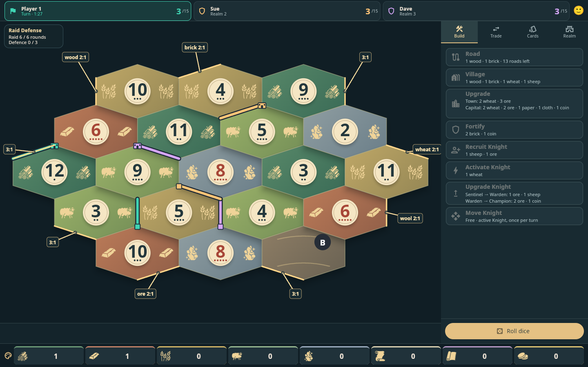
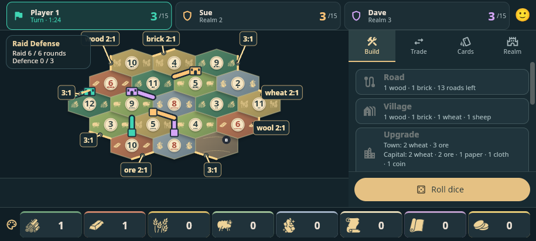

# Stone & Banner

Build settlements, claim roads, trade resources and defend your realm from bandit raids. Outsmart rival players and be the first to reach **15 Victory Points**.

**[Play in your browser](https://brandonp2412.github.io/stone-and-banner/)** · **[Download for Android](https://github.com/brandonp2412/stone-and-banner/releases)**



## Gameplay

- **Build a realm:** Settle a changing 19-hex island, gather resources from dice rolls, connect roads and upgrade villages into towns and capitals.
- **Make deals:** Trade with other players or bots to get what you need.
- **Protect your people:** Recruit knights, play strategy cards and prepare for recurring bandit raids.
- **Choose your opponents:** Play against AI, share a device with friends or invite remote players to a multiplayer game. Matches support **3–4 seats**.
- **Come back later:** Local matches autosave, with replay and match-history support.

## Screenshots




Portrait gameplay is also supported on mobile.

## Run locally

Built with Flutter for web, Android and Linux.

```sh
flutter pub get
flutter run -d chrome
```

Generate fresh web screenshots with:

```sh
uv run --with patchright==1.64.4 python -m patchright install chromium
uv run --with patchright==1.64.4 python tool/capture_readme_screenshots.py
```

The screenshot script starts a new match in an isolated browser profile. GitHub Actions also captures new screenshots when gameplay code changes, with the images available as downloadable workflow artifacts.
